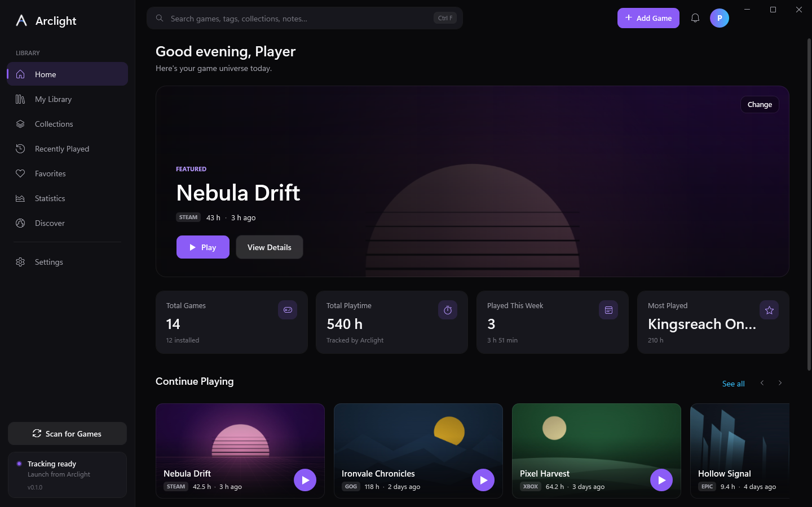
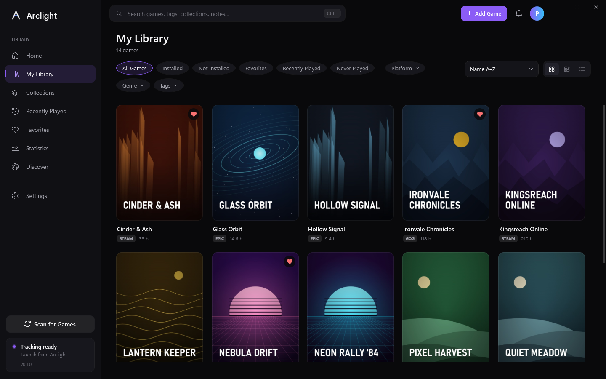
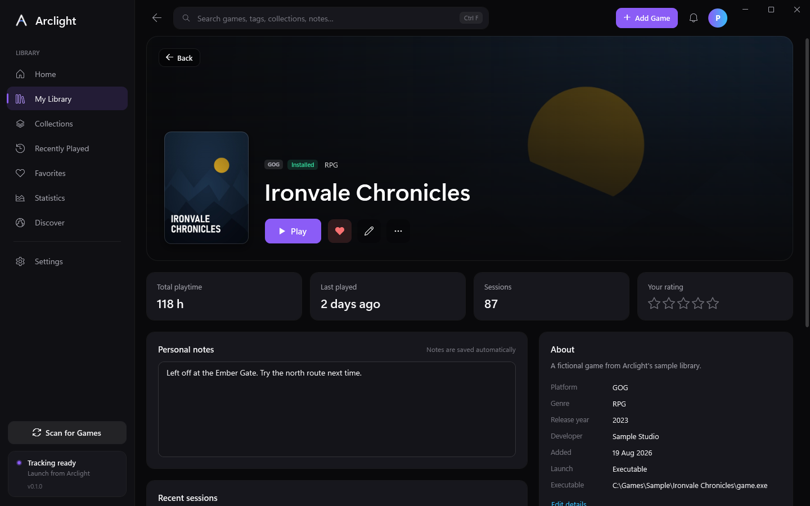
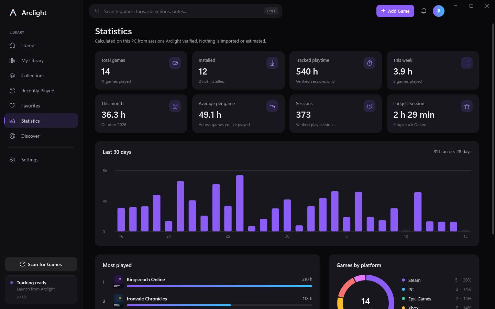
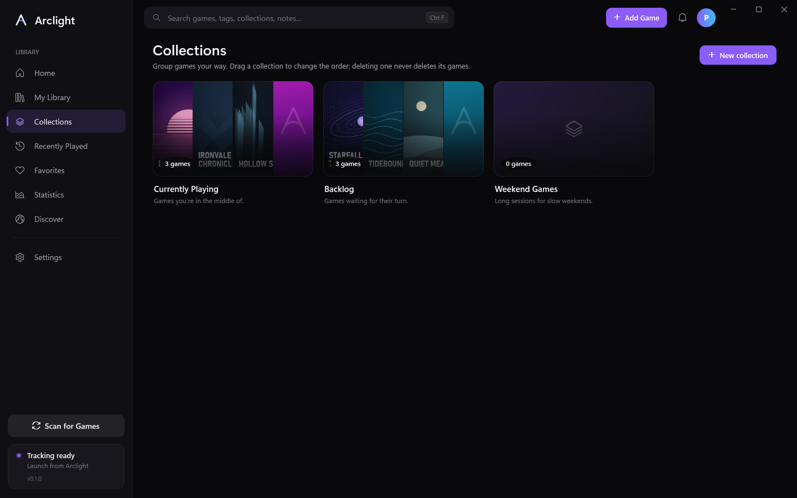

<p align="center">
  
</p>

<h1 align="center">Arclight</h1>

<p align="center"><strong>Your Games. One Universe.</strong><br />
A local-first game library and launcher for Windows that brings Steam, Epic Games, GOG, Xbox, Ubisoft Connect and standalone games together.</p>

<p align="center">
  <a href="https://github.com/efebalci569-dot/arclight/releases">Download</a> ·
  <a href="https://efebalci569-dot.github.io/arclight/">Website</a> ·
  <a href="docs/ARCHITECTURE.md">Architecture</a> ·
  <a href="docs/PLATFORM-SUPPORT.md">Platform support</a> ·
  <a href="docs/PRIVACY.md">Privacy</a>
</p>



> Screenshots use Arclight's built-in sample library of made-up games and generated artwork.

## What it does

- **One library for every launcher.** Scan for Games reads the install records that launchers already keep on your PC. Anything it can't detect can be added with Add a Game.
- **Real launching.** Games start through their own launcher (Steam, Epic, Ubisoft, Windows apps) or directly from their executable. When something goes wrong — the game moved, the launcher is missing, the game wants administrator rights — Arclight explains it and offers a fix.
- **Honest playtime.** Time is counted only while the game's own process runs. Launchers, crash reporters, anti-cheat helpers and time the PC was asleep never count, sessions survive crashes, and nothing is estimated or imported from other platforms.
- **Make it yours.** Favorites, collections (drag to reorder), tags, personal notes, 5-star ratings, a featured game on Home, statistics, accent colors and an OLED theme.
- **English and Turkish.** The interface follows your Windows display language and can be switched in Settings › General without restarting (Türkçe arayüz desteği).
- **Local-first.** No account and no server. Everything lives in a SQLite database on your PC that you can export to JSON.

| | |
|---|---|
|  |  |
|  |  |

## Platform support

| Platform | Detection | How games start |
|---|---|---|
| Steam | Supported — library folders and app manifests | `steam://rungameid/…` |
| Epic Games | Supported — launcher install manifests | Epic launcher link |
| GOG | Supported — GOG install records (with or without Galaxy) | The game's executable |
| Xbox / PC Game Pass | Experimental — games in `XboxGames` folders | Windows app id |
| Ubisoft Connect | Experimental — Ubisoft install records | `uplay://launch/…` |
| EA app | Detected only — add games manually | Your executable or link |
| Anything else | Folders you choose, or Add a Game | Executable, launcher link or custom command |

Details, limits and file locations are in [docs/PLATFORM-SUPPORT.md](docs/PLATFORM-SUPPORT.md).

## Install

1. Download `Arclight-<version>-win-x64-Setup.exe` (or the portable `.zip`) from [Releases](https://github.com/efebalci569-dot/arclight/releases).
2. Run it. It installs for your user only and never asks for administrator rights.
3. Arclight isn't code-signed yet, so Windows SmartScreen may warn on first run. Compare the file with `SHA256SUMS.txt` from the same release, then choose **More info › Run anyway**.

Requirements: Windows 10 1809+ or Windows 11, 64-bit. The .NET runtime is included.

The portable build keeps its data in a `Data` folder next to `Arclight.exe` (because of the bundled `portable.txt`). The installed build stores data in `%LOCALAPPDATA%\Arclight`; uninstalling leaves that folder and your games untouched.

## Build from source

You need the [.NET 10 SDK](https://dotnet.microsoft.com/download) on Windows (and Node.js 20+ for the website).

```bash
git clone https://github.com/efebalci569-dot/arclight.git
cd arclight
dotnet test
dotnet run --project src/Arclight.Desktop
```

Release files (self-contained exe, portable zip, installer if [Inno Setup 6](https://jrsoftware.org/isinfo.php) is installed, checksums):

```bash
powershell -ExecutionPolicy Bypass -File scripts/publish.ps1
```

Website:

```bash
cd src/Arclight.Web
npm install
npm run dev
```

Useful developer switches for `Arclight.exe`:

| Switch | Purpose |
|---|---|
| `--data-dir <folder>` | Use a separate library folder (handy for testing). |
| `--seed-demo` | With `--data-dir` pointing at an empty folder: create the fictional sample library used for screenshots. |
| `--lang en` / `--lang tr` | Use this interface language for this run only (the saved setting is not changed). |
| `--capture <file.png> [--page Library] [--size 1440x900] [--switch-lang tr]` | Render the window to a PNG and exit. `--switch-lang` changes the language after the page is shown, to check live switching. |
| `--minimized` | Start minimized (used by the startup entry). |

## Project layout

```
src/
  Arclight.Core/        Models, SQLite storage, library search/filter/sort, scan merging,
                        playtime tracking engine, statistics, launch validation (no UI, fully tested)
  Arclight.Platforms/   Read-only launcher scanners (Steam, Epic, GOG, Xbox, Ubisoft, EA, folders),
                        Windows process inspection and the game launcher
  Arclight.Desktop/     WPF app (MVVM): views, view models, theme, dialogs, tray, startup
  Arclight.Web/         React + TypeScript + Vite website
tests/                  xUnit tests for Core, Platforms and Desktop
installer/              Inno Setup script
scripts/                publish.ps1 (release build), generate-brand.ps1 (logo and icons)
assets/brand/           Logo (SVG/PNG) and the Windows .ico
docs/                   Architecture, platform support, privacy, releasing
.github/workflows/      CI, release and website deployment
```

## Contributing

Issues and pull requests are welcome. Please run `dotnet test` before opening a PR. New launcher support belongs in `src/Arclight.Platforms` as a separate `IPlatformScanner` with tests that use fake registry data and temporary folders — never real user files.

## License

[MIT](LICENSE). Arclight is not affiliated with Valve, Epic Games, Microsoft, CD PROJEKT, Ubisoft or Electronic Arts. Game names and trademarks belong to their owners.
